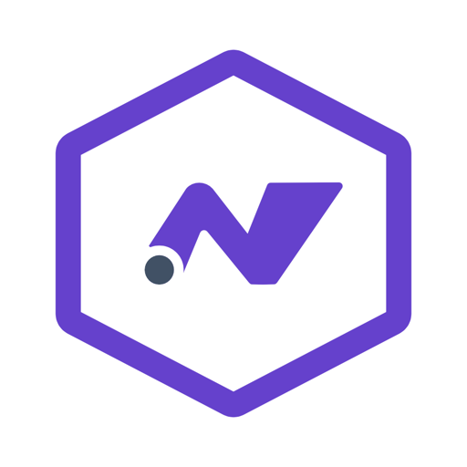

# .NET App Publisher



.NET App Publisher is a desktop utility for .NET developers who want a faster, safer way to build publish commands, inspect exactly what will run, and handle common platform workflows without living in the terminal.

It is built with Avalonia and currently supports Android, macOS, Windows, and iOS publish workflows for .NET projects.

## What it does

- Select a .NET project folder and auto-detect the `.csproj`
- Read project metadata and pick platform-appropriate target framework/runtime combinations
- Detect the project's effective version wherever it is declared — the csproj, `Directory.Build.props`, a central `Directory.Version.props`, or any imported props file (via MSBuild evaluation, falling back to the project file when `dotnet` is unavailable)
- Generate the Android APK on every publish, and check AAB once to add the Google Play bundle to the same build
- Generate macOS outputs with optional `.app` bundle creation
- Generate Windows publish outputs with `.exe` launcher support
- Generate iOS publish commands with archive/IPA toggles
- Toggle platform-specific publish settings including trimming, AOT, linker/shrinker, and cleanup behavior
- Keep the publish options consistent with each other: turning on an option switches on the companion it needs, turning off a prerequisite turns off everything that relied on it, and two options that cannot be used together are never both on. An optional companion is offered rather than forced
- Preview the exact `dotnet publish` command before running it
- Stream live publish output in the app
- Open the folder that actually holds the published APK/AAB — never a parent you have to dig through
- Detect and deploy to real Android phones and tablets over USB or Wi-Fi, alongside emulators
- See what the selected target reports about itself — model, Android version, API level, CPU ABI, transport, and readiness — in a row under the device selector
- Install as an in-place update (`adb install -r`) that keeps app data; a preflight compares the APK's signing certificate with the copy already on the device and blocks a mismatched build — with both fingerprints and its Google Play update impact — before any command runs, instead of wiping data for you
- Inspect what the device has installed for a package: who installed it, the version code it runs, and the certificate it carries, so you can tell whether a Play Store update can replace it
- Pair wireless debugging three ways: the Android 11+ pairing code, a QR code the phone scans (Developer options → Wireless debugging → **Pair device with QR code**), or the legacy `adb tcpip` step for Android 10 and older
- Browse the device's public folders (Downloads, Pictures, DCIM, Documents, Movies, Music), delete files with a confirmation, drag files from the computer into the open folder, and save device files back to the computer
- Detect real iPhone and iPad targets with `xcrun devicectl` (macOS, Xcode 15+) and install, launch, or stop a signed build on one
- Uninstall, launch, or close the app through `adb`: **Close app** stops every process *and* removes the app from Recents (the app switcher), so the app is really gone instead of only stopped. The installed app and its data are always kept
- Discover available Android emulators and launch the one you want
- Keep the device list live instead of refreshing by hand: while the Platform, Deploy, or Device Files section is open, a phone that is plugged in, authorized, or unplugged, and an emulator you start, appear and get selected automatically — and starting an emulator reports when it comes online
- Capture the app window to clipboard or disk with a visible countdown
- Hear a short alert when a task finishes — publish, deploy actions, device file transfers, and clipboard copies — and mute it from the speaker button in the header
- Publish Android App Bundles to Google Play from a dedicated Google Play workspace
- Configure the Google Desktop OAuth client ID directly in the app, with session-only or user-profile persistence and visible configured/not-configured status
- Connect a personal Google account with browser OAuth, choose internal, closed, open, or production tracks, add release notes, and submit staged or full rollouts
- Move a release between lines without opening the Play Console website: promote a tested build to production, remove a release from a testing line, halt a rollout, change the rollout percentage, or create a closed testing line
- See what it takes to move a connected device onto another line: which line it is effectively on, the version code the target line needs, and whether the other line has to stop serving first
- Keep Google OAuth tokens and Android upload-key passwords in memory for the current session; use **Clear session** or quit to remove them

## Why this exists

MAUI Android publish commands can become long and easy to get wrong, especially when switching between safer test builds and more aggressive optimized builds. This app keeps the command visible, keeps the options grouped in one place, and helps you iterate faster without losing track of what changed.

## Getting started

### Requirements

- .NET 10 SDK (the repository `global.json` pins the .NET 10 feature band)
- Android SDK command-line tools
- `adb` available on `PATH` for device and emulator actions (Android platform-tools 30.0.0 or newer for `adb pair` and `adb mdns`)
- Android `emulator` tool available on `PATH` or in the default SDK install location for AVD discovery and launch
- For real iOS devices: macOS with Xcode 15 or newer selected through `xcode-select`, the device paired once over USB and trusted, and Developer Mode enabled. Real-device file browsing is Android-only, because iOS app storage is sandboxed

### Run locally

```bash
dotnet build DotNetAppPublisher.slnx
dotnet run --project src/DotNetAppPublisher/DotNetAppPublisher.Desktop/DotNetAppPublisher.Desktop.csproj
dotnet run --project src/DotNetAppPublisher/DotNetAppPublisher.Browser/DotNetAppPublisher.Browser.csproj
```

## Commands

| Command | Purpose |
| --- | --- |
| `dotnet restore DotNetAppPublisher.slnx` | Restore NuGet packages |
| `dotnet build DotNetAppPublisher.slnx` | Build the solution |
| `dotnet run --project src/DotNetAppPublisher/DotNetAppPublisher.Desktop/DotNetAppPublisher.Desktop.csproj` | Launch the desktop app |
| `dotnet run --project src/DotNetAppPublisher/DotNetAppPublisher.Browser/DotNetAppPublisher.Browser.csproj` | Launch the browser host |
| `dotnet run --project tests/DotNetAppPublisher.Tests/DotNetAppPublisher.Tests.csproj` | Run the TUnit test suite |

### Main workflow

1. Pick the .NET project directory.
2. Review the detected `.csproj`, package id, and target framework.
3. Choose platform (`Android`, `macOS`, `Windows`, or `iOS`) and set the publish options for that slice.
4. Confirm the command preview looks correct.
5. Configure Android signing and the Google Play upload key from the Signing workspace.
6. Publish and watch the live output panel.
7. Open the output folder, or deploy to a real device or emulator from the Platform and Deploy sections.
8. Use Device Files to browse the selected Android device's public folders, send files to it, and save files from it.

## Project structure

```text
DotNetAppPublisher/
├── .github/
│   └── workflows/
├── docs/
│   └── dotnet-app-publisher-icon.png
├── Directory.Build.props
├── Directory.Packages.props
├── Directory.Version.props
├── tests/
│   └── DotNetAppPublisher.Tests/
├── DotNetAppPublisher.slnx
└── src/
    └── DotNetAppPublisher/
        ├── DotNetAppPublisher.Core/       # UI-free domain layer
        │   ├── Models/
        │   ├── Services/
        │   └── Features/
        │       ├── GooglePlay/
        │       │   ├── Authentication/
        │       │   ├── Releases/
        │       │   ├── Services/
        │       │   ├── Setup/
        │       │   ├── Signing/
        │       │   ├── State/
        │       │   └── Tracks/
        │       ├── Publishing/
        │       │   ├── Artifacts/
        │       │   ├── Build/
        │       │   ├── Configure/
        │       │   ├── Inspect/
        │       │   └── Process/
        │       ├── Deployment/
        │       │   ├── Android/
        │       │   └── Ios/
        │       └── Shared/
        ├── DotNetAppPublisher/            # Avalonia app: views and view models
        ├── DotNetAppPublisher.Browser/
        └── DotNetAppPublisher.Desktop/
```

The `DotNetAppPublisher.Core` library carries the publish option graph, the publish command
builder, the deployment services, and the Google Play API client. It has no Avalonia dependency,
so every rule in it is testable without a window. The app project holds the views, the view
models, and the Avalonia-bound adapters, and references the library.

## GitHub Actions

This repository includes Actions workflows for:

- CI validation on pushes and pull requests
- cross-platform desktop publish packaging on version tags

That gives the repo a solid starting point for sharing on GitHub without having to set up the basics later.

## Roadmap and wishlist

### Publish workflows

- Add guided presets for safe test builds, store-ready Android builds, and repeatable release profiles
- Add saved publish profiles per project

### Google Play support

The current Google Play slice provides a dedicated workspace for:

- personal Google account OAuth with session-only credentials
- internal, closed, open, and production tracks, discovered by their real identifiers
- localized release notes and staged or full rollouts
- AAB structure preflight, upload, commit, and status checks
- moving a release between lines: promote to another track, remove it from a testing line, halt it, or change its rollout
- creating a closed testing line
- in-memory upload-key setup from the Signing workspace, linked from the Google Play release card
- clear-session controls for OAuth and signing material

Google Play app creation, legal declarations, Play App Signing enrollment, production-access applications, managed publishing, and upload-key resets still require Play Console.

### Signing improvements

- Add better keystore validation before publish starts
- Add secure secret storage integration instead of plain text fields
- Add signing key rotation helpers
- Add automation for switching between debug, local release, and store signing identities

### Platform expansion

- Add iOS simulator discovery and launch
- Add richer iOS signing/export profile support
- Add Windows installer packaging presets
- Add platform-specific validation so unsupported options are hidden or disabled automatically

## Current status

The app is already useful for Android, macOS, Windows, and iOS publish flows, plus Android emulator checks, but it is still evolving. The roadmap above reflects the next useful improvements for shipping and store workflows.

## Development notes

- The SDK and publishing profile analysis, including .NET 10/.NET 11 compatibility, platform matrices, and tested publish combinations, is recorded in [docs/dotnet-10-11-publishing-research.md](docs/dotnet-10-11-publishing-research.md).
- The repository pins the supported .NET 10 LTS SDK line with `global.json`; .NET 11 RC tooling is not selected accidentally while it is still a release candidate.
- Google Play publishing requires an existing Play app and a public Google Desktop OAuth client ID. The client secret is never needed or stored by the desktop OAuth flow.
- The Google Play setup card can set the client ID, Java home, and Android SDK path for this app process, save supported values for future launches, remove them, open Google Cloud credentials, and open setup help. Each setup row includes step-by-step acquisition guidance and an official source link. On macOS, **Save** updates `~/.zprofile`; open a new terminal or restart the app to load it. On Linux, use **Use now** because this app does not modify shell startup files. Environment values are never written to the app database.
- The Google Play account card stays at the top of the release workspace; upload-key controls are grouped under Signing and link back from the App card.
- Raw OAuth tokens, service-account keys, and keystore passwords are never shown in command previews or persisted by the Google Play slice. Session credentials are cleared when the window closes.
- New Play apps, legal declarations, production access, managed publishing, and signing-key resets remain manual Play Console actions when the supported API does not expose them.
- Some .NET projects override trim-related properties in custom ways. .NET App Publisher detects common project-specific trim property patterns so AOT and trimming combinations can be emitted correctly.
- The publish options are related by one declarative graph, so the UI, the normalizer, and the command builder cannot disagree. Native AOT always trims — the .NET SDK fails the build with "PublishTrimmed is implied by native compilation and cannot be disabled." when trimming is off — so the graph keeps trimming on under AOT. ReadyToRun and single-file are mutually exclusive with AOT, trimming needs a self-contained publish, Android ahead-of-time compilation needs the linker, and the .ipa needs the archive.
- Google Play signs its downloads with the app signing key, not the upload key. A build signed with the upload key can never be replaced by a Play Store update, because Android only accepts an update when the signing certificate matches. The app compares the certificate of a local build with the one on the device, and reports the Play app signing certificate where the API exposes it.
- Google Play serves the highest version code a user is eligible for across every track, and never downgrades. Moving a device off a testing line therefore needs the release removed from that line *and* a production version code at least as high as the one on the device. Internal testing is exclusive: an internal tester receives only that track's version code, even when production is higher.
- The browser host uses Avalonia's software renderer, synchronizes its canvas backing store after startup, and disables desktop-only device discovery, elevated processes, file browsing, and Google OAuth in browser mode.
- The browser host links the native SkiaSharp library, so it needs the `wasm-tools` workload for the emscripten toolchain: run `dotnet workload install wasm-tools` before building it. Without that, the app fails at startup with `System.DllNotFoundException: libSkiaSharp`.
- The master-detail view narrows its navigation, stacks header actions, wraps form groups, and uses compact icon controls for low-emphasis actions at smaller window sizes.
- `Signing` and `Google Play` are adjacent master-detail destinations; routine status stays inline, while modal alerts are reserved for errors and confirmations with a title and vertically centered details.
- The navigation reads Project, Platform, Build, Signing, Google Play, Deploy, Device Files, Output, Log, so build output and the log stay side by side.
- Task alerts are played by one shared `AlertSoundService`; the header speaker button mutes them, and alerts that arrive within its coalesce window sound once.
- Release verification uses `dotnet restore -p:Configuration=Release`, a Release solution build, and the TUnit suite; no live Google Play or device calls are made by tests.

## Contributing

Small focused improvements are welcome, especially around publish validation, emulator ergonomics, packaging support, and release automation.

See [CONTRIBUTING.md](CONTRIBUTING.md) for local setup and pull request expectations.

## License

This project is licensed under the MIT License. See [LICENSE](LICENSE).
